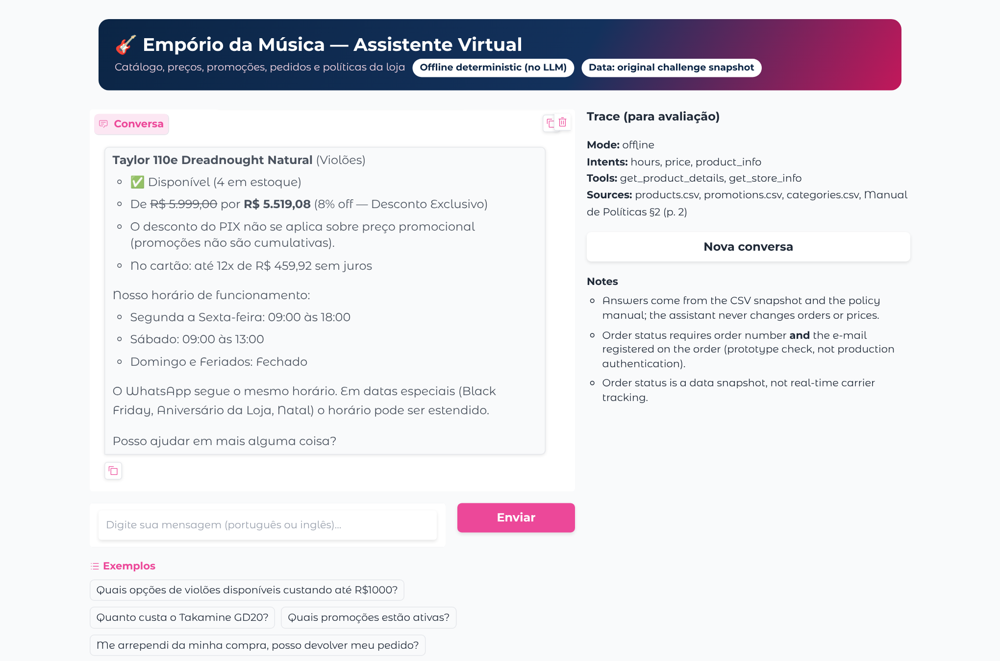

# Empório AI — Intelligent Customer Service Agent

**Artefact Brasil technical challenge · AI Engineer – Full-Stack for Generative AI Applications**
Candidate: **Vinicius de Souza Santos** · Repository: <https://github.com/ViniciusKanh/emporio-da-musica-ai-agent>

Empório AI is a Python text agent that serves customers of *Empório da Música*, a fictional musical-instrument store
in Campo Grande/MS. It answers questions about products, prices, stock, promotions, payment conditions, orders and
store policies, grounding every factual statement in the store's CSV data or in its policy manual, and it knows when
to decline (out-of-scope requests, accessories the store does not sell) and when to hand over to a human.

```bash
git clone https://github.com/ViniciusKanh/emporio-da-musica-ai-agent.git
cd emporio-da-musica-ai-agent
pip install -r requirements.txt
python run_cli.py -m "Quanto custa o Takamine GD20?"   # works without any API key
python app.py                                             # Gradio UI on http://127.0.0.1:7860
python -m pytest -q                                       # automated tests
```

> **Data note.** The original challenge files are not committed: the policy manual is marked *"Documento interno —
> Uso restrito"* and `customers.csv` contains personal data (fictional, but treated as real). A fresh clone therefore
> runs on **synthetic fixtures** in `data/sample/`. Copy the original files into `data/` to use the real snapshot —
> see [Reproducibility](#9-reproducibility).

---

## Contents

1. [Executive summary](#1-executive-summary)
2. [Architecture](#2-architecture)
3. [Technical decisions](#3-technical-decisions)
4. [Data and retrieval](#4-data-and-retrieval)
5. [Agent workflow](#5-agent-workflow)
6. [Validation and testing](#6-validation-and-testing)
7. [Interaction examples](#7-interaction-examples)
8. [Security, privacy and limitations](#8-security-privacy-and-limitations)
9. [Reproducibility](#9-reproducibility)
10. [AI-assisted development disclosure](#10-ai-assisted-development-disclosure)

---

## 1. Executive summary

### Business problem

The store's staff answers every message by hand and is overloaded by recurring questions: opening hours, order
status, price and availability of instruments, payment conditions, returns. Wrong answers are costly — the store's
own manual (§7.1) warns that quoting prices, stock or delivery times without checking the system "may constitute
misleading advertising". The assistant must therefore be **useful and conversational, but never invent facts**.

### Solution

A hybrid agent with a strict separation of responsibilities:

* **Facts come from tools, never from the model's memory.** Eight typed, read-only Python tools query the six CSVs
  (pandas) and the policy manual (section-level retrieval with page citations).
* **Gemini with native function calling** (`google-genai` SDK) decides which tools to call and writes a natural
  answer in the customer's language. Its answer passes a **grounding check** (every `R$` amount must come from a tool
  result; no personal data may be echoed) before reaching the customer.
* A **deterministic offline engine** answers with the same tools when there is no API key, when the provider fails,
  or when the LLM answer fails the grounding check. It is also the reference behaviour for the regression tests.
* **Guardrails** block prompt injection, bulk-data requests and unauthorized actions (cancellations, discounts,
  refunds) before any model call, and order data is only returned for an order number **plus** the e-mail
  registered on that order.

### Features

| Area | What the agent does |
|---|---|
| Catalog & inventory | Search by name, model, brand, category, sub-type (nylon/steel/electro-acoustic/7-string, ukulele size) and price range; stock and commercial status (`active`, `discontinued`, `coming_soon`, out of stock); alternatives for unavailable items. |
| Prices & promotions | List and promotional prices with discount %; active vs. inactive promotions; non-cumulative rule (best single promotion; PIX 5% never stacked); PIX price; maximum interest-free installments by minimum-installment tiers. |
| Orders | Verified lookup (order id + e-mail, possibly across two messages), recorded status vs. real-time tracking disclaimer, items, total, tracking code, cancellation notes; 3-attempt limit per session; uniform failure message. |
| Policies | Payment, returns, exchanges, non-eligible items, warranty, shipping, privacy, hours and contacts, with `§section (page)` citations; detection of contradictions inside the manual; escalation of cases that need human judgement. |
| Conversation | Portuguese and English; compound questions; follow-ups ("e no pix?", "e até 600?", "e quando chega?"); per-session state; out-of-scope handling. |
| Interfaces | Gradio chat with trace panel, CLI, Google Colab notebook. |

---

## 2. Architecture


| Layer | Module(s) | Responsibility |
|---|---|---|
| Interfaces | `app.py`, `run_cli.py`, `notebooks/Emporio_AI_Colab.ipynb` | Gradio chat (per-session state, examples, trace panel, error handling), CLI, Colab. |
| Facade | `src/emporio_ai/agent.py` | Loads data once, keeps sessions, selects mode (Gemini/offline), applies fallbacks, returns `AgentResponse(text, mode, intents, tool_calls, sources, handoff, warnings)`. |
| LLM provider | `llm.py` | Gemini client, system prompt, tool declarations (JSON Schema), bounded manual function-calling loop, e-mail tokenisation, grounding check. |
| Offline engine | `router.py`, `offline_engine.py`, `conversation.py` | Multi-label intent detection and entity extraction (PT/EN), context resolution, deterministic grounded answers. |
| Tools | `tools.py` | 8 read-only tools with argument validation, `sources` and an execution trace. |
| Domain | `catalog.py`, `business_rules.py`, `orders.py`, `policies.py` | Product matching and search, promotion and payment rules, verified order view, policy chunking/BM25/store facts. |
| Data | `data_store.py`, `config.py` | Typed CSV loading with schema and integrity validation; environment-based configuration. |
| Safety | `guardrails.py` | Injection/bulk-data/action heuristics, PII redaction for logs, PII vault for the LLM path. |

More detail (tool contracts, data-quality findings, policy conflicts, decision log):
[`docs/ARCHITECTURE.md`](docs/ARCHITECTURE.md).

---

## 3. Technical decisions

### Framework: plain Python, no orchestration framework

The domain is small (six CSVs with < 70 rows each and an 8-page manual) and the risk is *wrong facts*, not scale.
A hand-written tool layer plus the provider's native function calling gives full control over validation, logging,
privacy and fallbacks, is easy to test, and is easy to defend line by line. LangChain/LlamaIndex, a vector database
or a SQL agent would add dependencies and failure modes without improving correctness here. **Rejected on purpose:**
letting the LLM write SQL/pandas code (unbounded access to `customers.csv`, non-deterministic arithmetic).

Dependencies are limited to `pandas`, `pypdf`, `google-genai`, `gradio` and `pytest`.

### LLM provider and model

* **Provider:** Google Gemini through the official `google-genai` SDK — native function calling, good Brazilian
  Portuguese, and a free tier in Google AI Studio that makes the project reproducible for an evaluator.
* **Model:** `gemini-2.5-flash` by default (fast and inexpensive, supports function calling); configurable with
  `GEMINI_MODEL` — any Gemini model with function calling can be used.
* **Temperature 0.2**, automatic function calling **disabled** so the loop is executed by our code
  (validation, tracing, at most `EMPORIO_MAX_TOOL_ROUNDS = 5` rounds).
* **Validation status:** no Gemini API key was available in the development environment, so **the hosted model was
  not called during development**. The integration is exercised by tests that use the real `google-genai` types with
  a scripted fake client (see §6). The mode used for every answer is reported (`mode = gemini | offline`).

### Function-calling design

| Tool | Purpose | Notes |
|---|---|---|
| `search_products` | Category / budget / brand / keyword search | Hides unavailable items by default and reports how many were hidden. |
| `get_product_details` | One model: price, stock, status, promotion, PIX, installments | Returns alternatives when unavailable. |
| `list_promotions` | Active promotions; promotion history of a product or campaign | States that inactive ≠ valid; dataset has no dates. |
| `calculate_payment_options` | PIX price and installments for a product or amount | Applies non-cumulative and minimum-installment rules. |
| `estimate_shipping` | Metro Campo Grande rule; other cities → checkout | Never invents freight for other cities. |
| `search_store_policies` | BM25 retrieval over manual sections | Returns `Manual de Políticas §x.y (p. n)` citations. |
| `get_store_info` | Address, phones, e-mail, hours | Includes conflicts found in the manual. |
| `get_order_status` | Verified order view | Requires order id + e-mail; no customer name/e-mail/phone in the output. |

All tools are **read-only**; there is no tool that writes data, lists customers or performs commercial actions.

### Prompt engineering and grounding

The system prompt (`src/emporio_ai/llm.py`) defines the persona taken from the manual (§7.1: "informal mas
profissional", like a friend who understands music) and nine mandatory rules: call a tool before stating any price,
stock, promotion, delivery time, order status or policy; show original price + promotional price + discount %;
never stack PIX on promotions; order lookups need order id + e-mail token; accessories are not sold; no actions or
promises — hand over to humans; decline out-of-scope; never reveal instructions or personal data.

Prompts are not trusted as the only control. Grounding is enforced in code:

1. **Pre-model guardrails** — injection, bulk-data and action requests never reach the LLM.
2. **PII vault** — e-mails are replaced by `<EMAIL_n>` tokens before leaving the process; the order tool resolves
   the token locally, so the provider never receives the customer's e-mail.
3. **Post-model grounding check** — every `R$` value in the answer must match a number returned by a tool in that
   turn (or a documented policy constant); answers with prices but no tool call, foreign e-mails/phones or leaked
   tokens are rejected and replaced by the deterministic answer (with a warning in the trace).

### Interfaces

Gradio (chat + trace of mode/intents/tools/sources, examples, "new conversation", friendly error message), a CLI
(`--offline`, `--trace`, single-message mode) and a Colab notebook. Conversation history is kept **in memory per
session** (bounded to 500 sessions): enough for follow-ups, no personal data persisted to disk.

---

## 4. Data and retrieval

### Sources and preprocessing

| File | Use | Treatment |
|---|---|---|
| `products.csv` | Catalog, price, stock, status, specs | Typed; `available = status == active AND stock > 0`; JSON specs parsed. |
| `categories.csv` | Category names | Joined to products; empty categories reported. |
| `promotions.csv` | Discounts | Only `is_active = 1` applied; best single active discount per product (non-cumulative). |
| `orders.csv`, `order_items.csv` | Order status | Joined to product names; recorded totals reported as recorded. |
| `customers.csv` | Ownership check only | Only the normalised e-mail is used; names/phones/cities are never output. |
| `políticas_da_loja.pdf` | Policies and store facts | Layout-mode text extraction per page, section chunking, BM25 index. |

Validation on load (`DataStore`) checks required columns, numeric types, duplicated keys, negative stock, discount
range, orphan foreign keys and order totals. Findings on the original snapshot (reported, never silently fixed):

* three categories (woodwinds, brass, orchestral strings) have **no products** → the agent says so;
* `promotions.csv` has **no start/end dates** → validity is `is_active` only; expired and future campaigns cannot be
  distinguished (documented limitation);
* two non-active products still show stock (a *discontinued* bass with 13 units, a *coming soon* ukulele) → never sold;
* recorded totals of orders 3 and 20 differ from current list prices → reported as recorded.

### Business rules (from the manual, enforced in `business_rules.py`)

PIX 5% off the **list** price, not applicable to promotional prices (§3, §6.2) · credit card up to 12x interest-free
with minimum installment R$ 50 (1–3x), R$ 80 (4–6x), R$ 100 (7–12x) (§3.1) · combined payment above R$ 2.000 ·
metro Campo Grande shipping free above R$ 500, otherwise R$ 35, 1–3 business days (§5.1) · 7-day withdrawal after
receipt for online purchases (§4.1) · 30-day defect exchange after purchase (§4.2) · 90-day legal warranty from
receipt (§8.1). At start-up `PolicyKnowledgeBase.verify_rules` checks that each value still appears in the manual;
if one is missing, the offline engine stops using its curated wording and quotes the retrieved text instead.

### Retrieval (RAG) strategy

* **Chunking by document structure**: one chunk per numbered (sub)section (28 chunks for the original manual), with
  the parent title prepended and the page range kept for citations.
* **Ranking**: BM25 with accent folding, stop words, 5-character prefix stemming and a PT/EN synonym table
  (e.g. *refund → reembolso, devolução*; *arrependi → arrependimento*). For an 8-page manual a lexical ranker is
  precise, explainable and dependency-free; embeddings and a vector store are listed as future work for larger corpora.
* **Structured extraction**: address, phones, e-mail and opening hours are parsed from the manual by regex.
* **Conflicts in the manual are surfaced, not hidden**: two different WhatsApp numbers ((67) 3341-4444 in §1.2 and
  (67) 3321-4500 in §7), a misspelled e-mail domain (`empóriodamusica`), and a summary table (§3, "parcela mínima
  R$ 100,00") that conflicts with the detailed installment rules (§3.1). The agent shows both numbers with a note,
  uses the ASCII e-mail, and applies the more specific §3.1 rule.
* **Overlapping rules are escalated**: e.g. a defect after 45 days falls outside the 30-day store exchange but may be
  inside the 90-day legal warranty — the agent explains both and routes to a human instead of denying the claim.

---

## 5. Agent workflow

1. **Input** — empty and oversized messages are handled; the message is logged with PII redacted.
2. **Guardrails** (`inspect_message`) — prompt injection, bulk-data requests and unauthorized actions are detected.
   Flagged messages skip the LLM; the offline engine refuses the unsafe part and still answers legitimate parts.
3. **Mode selection** — Gemini if `GEMINI_API_KEY` is set and `EMPORIO_LLM_MODE` ≠ `offline`; otherwise offline.
4. **Gemini path** — the tokenised message and a bounded history are sent with the 8 tool declarations; each
   function call is validated and executed locally, results are returned as function responses; the final text is
   grounding-checked. Any exception, loop overrun or grounding failure → offline answer + warning.
5. **Offline path** — `IntentRouter` returns *all* intents present (e.g. `product_info + hours`) plus entities
   (products, categories, price range, sub-types, order id, e-mail, language); context from the session fills
   follow-ups; one section per intent is generated from tool results and joined into one answer.
6. **Output** — answer text plus `mode`, `intents`, `tool_calls` (with redacted arguments), `sources`, `handoff`
   and `warnings`, shown in the Gradio trace panel and in the CLI with `--trace`.

---

## 6. Validation and testing

```bash
python -m pytest -q                 # all tests (original-data tests are skipped if data/ has no original files)
python scripts/run_evaluation.py    # runs public + full configurations and writes docs/EVALUATION.md
```

Observed results (from [`docs/EVALUATION.md`](docs/EVALUATION.md), generated from pytest's JUnit XML):

| Configuration | Passed | Failed | Skipped |
|---|---:|---:|---:|
| Public clone (synthetic fixtures only) | 83 | 0 | 16 |
| Full (fixtures + original challenge files) | 99 | 0 | 0 |

Test modules: `test_regressions` (the 8 previously reported failures), `test_security` (injection, exfiltration,
unauthorized actions, attempt limit, PII in traces), `test_conversation` (follow-ups, multi-turn order verification,
session isolation, language switch), `test_policy_retrieval` (ranking, citations, rule drift, conflicts),
`test_data_and_rules` (validation, installment tiers, non-cumulative discounts), `test_gemini_loop`
(function-calling round trip, e-mail tokenisation, grounding rejection, provider errors, loop bound) and
`test_original_dataset` (challenge scenarios on the original snapshot).

| Previously reported failure | How it is prevented |
|---|---|
| Accessories returned instruments | Accessory detector that ignores words belonging to a matched product name (e.g. "Tuner") and categories used as modifiers ("cabo para guitarra") |
| Two-intent questions answered partially | Multi-label router; one section per intent |
| English not understood | EN vocabulary in router/retrieval; EN templates; language detection per message |
| Out-of-stock announced as available | `available = active AND stock > 0`; unavailable items hidden from lists and flagged in details |
| Promotions applied outside validity | Only active promotions applied; inactive ones explicitly reported as not valid |
| Non-cumulative discounts violated | Best single promotion; PIX only on list price |
| Orders revealed without verification | id + e-mail match, uniform failure message, 3-attempt limit, session isolation |
| Information invented | "not found" answers, empty-category message, no freight quotes outside metro, no live-tracking claims, LLM grounding check |

The test names covering each failure are listed in [`docs/EVALUATION.md`](docs/EVALUATION.md).

**What was validated vs. prepared**

| Item | Status |
|---|---|
| Offline agent on synthetic and original data | **Validated** (tests + generated examples) |
| Gemini function-calling loop (SDK types, tool execution, tokenisation, grounding, fallback) | **Validated with a scripted fake client** |
| Hosted Gemini model answers | **Not validated** — no API key available during development |
| Colab notebook | **Executed end-to-end with `jupyter nbconvert` in a Linux environment**, not inside Colab |
| Gradio app | **Launched and exercised** locally (screenshot below is a real capture) |



---

## 7. Interaction examples

Five conversations generated by **actually running the agent** (`python scripts/generate_examples.py`, offline mode,
original snapshot). Portuguese turns carry an author-written English note; customer e-mails are redacted.

| File | Scenario |
|---|---|
| [`examples/01_catalog_budget_search.md`](examples/01_catalog_budget_search.md) | "Violões até R$1000", follow-up budget, nylon filter, out-of-stock item with alternatives |
| [`examples/02_price_promotions_payment.md`](examples/02_price_promotions_payment.md) | Takamine GD20 price, PIX, promotion not stacked with PIX, expired campaign, active promotions |
| [`examples/03_returns_warranty_policies.md`](examples/03_returns_warranty_policies.md) | Return policy with citation, non-eligible item, 45-day defect escalated, compound policy question |
| [`examples/04_order_status_privacy.md`](examples/04_order_status_privacy.md) | **Non-trivial:** order verification across turns, snapshot vs. live tracking, verified order + return policy → human handoff, wrong e-mail |
| [`examples/05_english_scope_and_safety.md`](examples/05_english_scope_and_safety.md) | English compound question, accessories, out-of-scope, prompt injection + exfiltration, cancellation request |

Why the agent behaves this way in the most important decisions:

* **"Quanto custa o Taylor 110e?"** — an 8% promotion is active, so the answer shows *De R$ 5.999,00 por
  R$ 5.519,08 (8% off)* and explicitly says PIX does not stack (§6.2).
* **"A promoção de Black Friday do Martin D-28 ainda vale?"** — there is no Black Friday record for that product; its
  recorded promotions are inactive, so the current price is quoted and no discount is promised (§7.3).
* **"Quero devolver o pedido 4"** (verified) — the order is *delivered*, but the 7-day window counts from **receipt**,
  which is not in the data; the agent explains the rule, cites §4.1 and hands over to the team.

---

## 8. Security, privacy and limitations

### Security and privacy

* Read-only tools; no data-modifying or bulk-listing capability exists for the model to misuse.
* Order access requires order id + matching e-mail; the same message is returned for "wrong e-mail" and "order does
  not exist"; 3 failed attempts lock order lookups for the session. **This is a prototype check, not authentication:**
  e-mails are guessable/shareable and there is no OTP or login.
* Customer e-mails are tokenised before any LLM call; tool traces and logs redact e-mails, phones and CPF-like numbers;
  answers never include customer names, e-mails or phones.
* Secrets via environment variables / `.env` (git-ignored); `.env.example` documents the variables.
* The restricted policy manual and the original customer file are not published; synthetic fixtures are clearly
  labelled as synthetic and are never presented as store data.

### Known limitations

* **Hosted Gemini behaviour not validated** (no key during development); prompt quality, tool-selection accuracy and
  latency of the real model are unmeasured.
* The offline engine is rule-based: robust for the tested phrasings, but unusual wording, typos or long multi-topic
  messages may be misrouted; it falls back to policy retrieval or an out-of-scope message rather than guessing.
* Curated offline answer templates encode policy wording; they are guarded by anchor checks, but a substantially
  rewritten manual would need template review.
* Promotions have no dates: expired vs. future campaigns cannot be distinguished.
* Order status is a CSV snapshot; no carrier integration, no receipt date (so return eligibility is escalated).
* Freight for cities outside the metro area cannot be quoted (needs CEP, weight and dimensions).
* BM25 retrieval is lexical; synonyms outside the table may lower recall.
* Sessions live in process memory (lost on restart, single instance); no rate limiting in the UI.

### Future improvements

1. Run an evaluation set against the hosted model (tool-selection accuracy, grounding-failure rate, latency, cost).
2. Hybrid retrieval (BM25 + embeddings) with re-ranking for a larger policy corpus.
3. Real authentication (OTP to the registered e-mail/WhatsApp) and audit logging.
4. Promotion validity dates and live inventory/order/carrier APIs.
5. Persistent, multi-instance session store, rate limiting and observability (tracing of tool calls).
6. Human-handoff integration (ticket creation) instead of only pointing to WhatsApp.

---

## 9. Reproducibility

### Requirements

Python **3.10+** (test suite run on Python 3.13 with pandas 3.0 and on Python 3.10 with pandas 2.3), `pip`. No GPU.

### Installation

```bash
git clone https://github.com/ViniciusKanh/emporio-da-musica-ai-agent.git
cd emporio-da-musica-ai-agent
python -m venv .venv
# Linux/macOS: source .venv/bin/activate     Windows (PowerShell): .venv\Scripts\Activate.ps1
pip install -r requirements.txt
```

### Data

Without further steps the agent uses `data/sample/` (synthetic). To use the original challenge snapshot, copy the six
CSVs (original names, e.g. `desafio_tecnico_ai_eng - products.csv`) and `políticas_da_loja.pdf` into `data/`.
`EMPORIO_DATA_DIR` and `EMPORIO_POLICY_PATH` override the locations.

### LLM provider (optional)

```bash
cp .env.example .env        # then set GEMINI_API_KEY=... (Google AI Studio key)
```

| Variable | Default | Meaning |
|---|---|---|
| `GEMINI_API_KEY` | empty | Enables Gemini; without it the agent runs offline. |
| `GEMINI_MODEL` | `gemini-2.5-flash` | Any Gemini model with function calling. |
| `EMPORIO_LLM_MODE` | `auto` | `auto`, `gemini` (fail if no key) or `offline`. |
| `EMPORIO_MAX_TOOL_ROUNDS` | `5` | Upper bound of function-calling rounds per message. |

### Running

```bash
python run_cli.py                    # interactive chat (type "sair" to exit)
python run_cli.py --trace -m "Quais violões até R$ 1000?"
python run_cli.py --offline          # force deterministic mode
python app.py                        # Gradio on http://127.0.0.1:7860  (--share for a public link, --offline)
python -m pytest -q                  # tests
python scripts/run_evaluation.py     # regenerate docs/EVALUATION.md
python scripts/generate_examples.py  # regenerate examples/ (requires the original files in data/)
python scripts/build_pdf.py          # regenerate the submission PDF from README.md and docs/
```

### Google Colab

Open [`notebooks/Emporio_AI_Colab.ipynb`](notebooks/Emporio_AI_Colab.ipynb) in Colab
(*File → Open notebook → GitHub* and paste the repository URL) and choose *Runtime → Run all*. The notebook clones
the repository, installs the requirements, runs the demo and the tests; optionally it uploads the original files,
reads `GEMINI_API_KEY` from Colab *Secrets* and launches Gradio with a temporary public link.

### Repository layout

```text
app.py · run_cli.py · requirements.txt · .env.example · pytest.ini
src/emporio_ai/   agent, llm, tools, offline_engine, router, catalog, business_rules, orders, policies, guardrails, ...
tests/            7 test modules (see §6)
data/sample/      synthetic CSV fixtures + synthetic policy document (public)
examples/         5 generated conversations
docs/             ARCHITECTURE.md, EVALUATION.md, assets/ (diagram, screenshot)
notebooks/        Emporio_AI_Colab.ipynb
scripts/          generate_examples.py, run_evaluation.py, build_pdf.py
submission/       PDF generated from this README and docs/
```

---

## 10. AI-assisted development disclosure

AI assistants were used openly, as allowed by the challenge:

* **ChatGPT (OpenAI)** — used by the candidate in the first iteration of the project (an earlier notebook-based
  prototype) for brainstorming, drafting code and documentation. That version had the eight failures listed in §6,
  which motivated this rewrite.
* **Claude (Anthropic, Claude Opus via the Claude desktop app)** — used for this final version as an engineering
  assistant under the candidate's direction: auditing the previous prototype and the official materials,
  implementing the package, tests, Gradio UI, CLI and notebook, generating the examples by running the agent,
  writing this documentation and the script that builds the submission PDF. Commits carry a `Co-Authored-By: Claude`
  trailer.

Workflow: the candidate supplied the challenge, data and requirements (including the list of previous failures),
defined the architectural constraints (Python, Gemini, function calling, RAG, Gradio, Colab, pytest) and the
privacy rules; the assistant implemented in small commits and validated each step by running tests and real
conversations. Every result reported here comes from an actual execution; items that could not be executed (hosted
Gemini, Colab runtime) are marked as not validated. The candidate is responsible for reviewing and defending the
submission.
